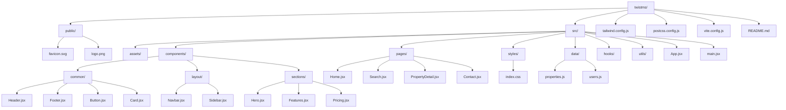

# TwistMS Properties – USA Real‑Estate Marketplace

## 📌 Project Overview
TwistMS Properties is a **USA‑focused online real‑estate marketplace** where property owners, independent agents, and the company can list, promote, buy, sell, and rent properties. The platform will support residential, commercial, land, rental, and investment listings with both free and paid options.

## 🎯 Business Goals & Budget
| Item | Detail |
|------|--------|
| **Primary Market** | United States – all 50 states |
| **Currency / Language** | USD / English |
| **Domain** | `twistmsproperties.com` (purchased) |
| **Hosting** | Hostinger Business Web Hosting |
| **Initial Phase‑1 Budget** | **15 k PKR** |
| **Target MVP Launch** | Within **1 month** |
| **Expected Launch Listings** | 500 properties |
| **User Growth Target** | 5,000+ registered users in first 3 months |

> **Note:** The $100 budget is for a realistic MVP scope. Advanced features are planned for later phases.

## 🗓️ Development Roadmap (Phases)
| Phase | Duration | Core Deliverables |
|-------|----------|-------------------|
| **Phase 1 – MVP** | 1 month | • Home page & branding<br>• User registration & login (Buyer, Seller, Agent, Admin)<br>• Property submission & admin approval workflow<br>• Property detail pages<br>• Search & basic filters<br>• Basic Google‑Maps integration<br>• Responsive design & SEO basics<br>• Security (SSL, hashed passwords, 2FA) |
| **Phase 2 – Marketplace Expansion** | 2–3 months | • Seller/Agent dashboards<br>• Paid & premium listings & subscription plans<br>• Payment gateway integration (Stripe/PayPal etc.)<br>• Agent profiles & reviews<br>• Appointment booking & WhatsApp integration<br>• Internal messaging system |
| **Phase 3 – Advanced Platform** | 4–6 months | • MLS/IDX integration<br>• AI chatbot & property recommendations<br>• AI‑generated descriptions & promotional videos<br>• Advanced analytics & lead management<br>• Social‑media auto‑share & ad management |

## 💡 MVP Scope (What fits the 15 k PKR budget)
- **Static site** built with **React 19**, **Vite**, and **Tailwind CSS** (re‑usable component library).
- Home page, property search, property detail page, and simple contact form.
- Four user roles with minimal UI (no full dashboards).
- Free listings only; paid/premium features deferred to later phases.
- Basic Google‑Maps embed (no custom styling).
- Media upload limited to **5 photos** per listing (client‑side compression).
- Basic SEO (meta tags, sitemap generation).
- Security basics (HTTPS, password hashing, simple email verification).

## 🛠️ Tech Stack (Reusable & Professional)
- **React 19** – UI library
- **Vite** – dev server & bundler
- **Tailwind CSS** – utility‑first styling (custom brand palette)
- **React Router** – client‑side routing (optional, can be added later)
- **Node ≥ 18** & **npm** – package manager
- **Git** – version control
- **Hostinger** – hosting (compatible with static build or WordPress later)

## 📂 Project Structure (generic, reusable)


## 📄 README Content (this file)
The file includes:
- Project overview & business goals
- Budget & timeline
- MVP scope aligned with the 15 k PKR budget
- Phase‑wise roadmap
- Tech stack and reusable folder layout diagram
- Next‑step checklist for developers

## ✅ Next Steps for Development
1. **Initialize Git repo**
   ```bash
   cd e:\\QuantaXore\\twistms
   git init && git add . && git commit -m "Initial scaffold"
   ```
2. **Install React Router** (optional for multi‑page navigation)
   ```bash
   npm install react-router-dom
   ```
3. **Create generic UI components** (`Header.jsx`, `Footer.jsx`, `Button.jsx`, `Card.jsx`) – I can scaffold them now if you want.
4. **Add placeholder data** in `src/data/` (sample property objects).
5. **Run the dev server**
   ```bash
   npm run dev
   ```
6. **Iterate on MVP** – focus on the Home page, property search, detail view, and basic user auth.

---
### 📦 Budget Breakdown (Phase‑1 – $100 USD)
| Cost Item | Approx. USD |
|-----------|------------|
| Developer time (≈ 8 hrs) | $80 |
| Domain renewal (annual) | $12 |
| Hostinger Business plan (monthly) | $8 |
| **Total** | **$100** |

> Subsequent phases will incur additional costs for paid plugins, AI APIs, MLS/IDX licences, and higher‑tier hosting.

## 📜 Legal & Compliance
- Include **Privacy Policy**, **Terms & Conditions**, **Cookie Consent**.
- Ensure **Fair Housing Act** compliance and **CCPA/CPRA** privacy requirements for US users.
- Provide a **Verified Property** badge only after admin approval.

---
### 🎉 Ready to go!
The scaffold is in place, Tailwind is configured, and a starter Home page exists. With the MVP scope defined, you can now focus on building out the remaining pages and user flows while staying within the $100 budget.

*Happy coding!*
## 📄 README Content (this file)
The file includes:
- Project overview & business goals
- Budget & timeline
- MVP scope aligned with the 15 k PKR budget
- Phase‑wise roadmap
- Tech stack and reusable folder layout diagram
- Next‑step checklist for developers

## ✅ Next Steps for Development
1. **Initialize Git repo**
   ```bash
   cd e:\\QuantaXore\\twistms
   git init && git add . && git commit -m "Initial scaffold"
   ```
2. **Install React Router** (optional for multi‑page navigation)
   ```bash
   npm install react-router-dom
   ```
3. **Create generic UI components** (`Header.jsx`, `Footer.jsx`, `Button.jsx`, `Card.jsx`) – I can scaffold them now if you want.
4. **Add placeholder data** in `src/data/` (sample property objects).
5. **Run the dev server**
   ```bash
   npm run dev
   ```
6. **Iterate on MVP** – focus on the Home page, property search, detail view, and basic user auth.

---
### 📦 Budget Breakdown (Phase‑1 – $100 USD)
| Cost Item | Approx. USD |
|-----------|------------|
| Developer time (≈ 8 hrs) | $80 |
| Domain renewal (annual) | $12 |
| Hostinger Business plan (monthly) | $8 |
| **Total** | **$100** |

> Subsequent phases will incur additional costs for paid plugins, AI APIs, MLS/IDX licences, and higher‑tier hosting.

## 📜 Legal & Compliance
- Include **Privacy Policy**, **Terms & Conditions**, **Cookie Consent**.
- Ensure **Fair Housing Act** compliance and **CCPA/CPRA** privacy requirements for US users.
- Provide a **Verified Property** badge only after admin approval.

---
### 🎉 Ready to go!
The scaffold is in place, Tailwind is configured, and a starter Home page exists. With the MVP scope defined, you can now focus on building out the remaining pages and user flows while staying within the $100 budget.

*Happy coding!*
